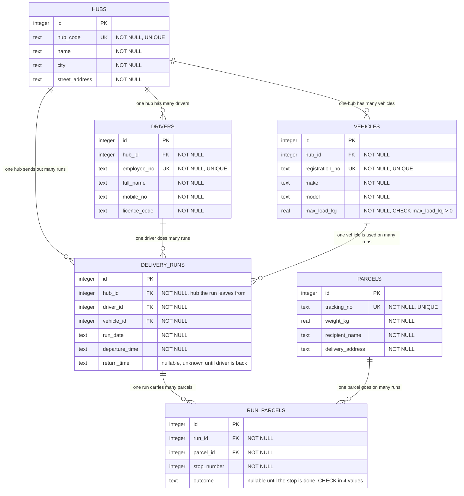

# Delivery Runs ERD

Paste the Mermaid block below into your GitLab wiki page titled **Delivery Runs ERD**
(the wiki editor renders ```` ```mermaid ```` blocks), or redraw it in the
**Insert or edit diagram** editor (Entity Relation shapes) as the brief requires.
Every table, column, type, key and relationship label you need is listed here.



## Multi-column constraints (show these on the ERD as notes)

| Table | Constraint | Business rule |
|---|---|---|
| `delivery_runs` | `UNIQUE (driver_id, run_date)` | a driver does at most one run per date |
| `delivery_runs` | `UNIQUE (vehicle_id, run_date)` | a vehicle is used for at most one run per date |
| `run_parcels` | `UNIQUE (run_id, parcel_id)` | a parcel is never loaded twice onto the same run |
| `run_parcels` | `UNIQUE (run_id, stop_number)` | no two parcels on a run share a stop number |
| `run_parcels` | `CHECK (outcome IN ('DELIVERED','NO_ONE_HOME','WRONG_ADDRESS','REFUSED'))` | outcome is one of the four values, or empty (NULL) |
| `vehicles` | `CHECK (max_load_kg > 0)` | maximum load is greater than zero |

## Crow's foot reading

Every relationship is **exactly one (`||`)** on the parent side and **zero or more (`o{`)**
on the child side. "Zero or more" is used on the many side because a newly opened hub may have
no drivers/vehicles yet, and a driver, vehicle, run or parcel can exist before it is attached to a
run. Foreign keys sit on the "many" side. `run_parcels` is the junction table that resolves the
many-to-many relationship between `delivery_runs` and `parcels`, and carries `stop_number` and `outcome`.
